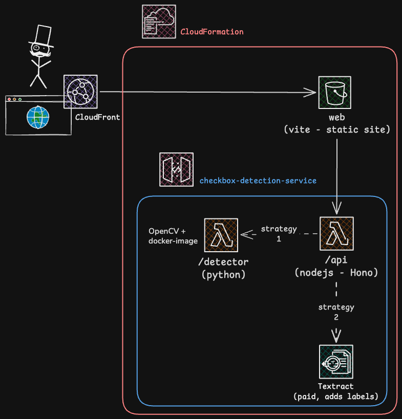

# Checkbox Detection Service

Detects and classifies checkboxes (filled or unfilled) in scanned document images. Built as a take-home technical challenge.

Live demo: https://d2bz9c0bd04oia.cloudfront.net

## Project structure

```
apps/
  api/        Node.js + TypeScript + Hono API (AWS Lambda)
  web/        React + Vite + TypeScript frontend
services/
  detector/   Python + OpenCV checkbox detection (Lambda container image)
docs/
  adr/                   Architecture decision records
  challenge/             Original brief + sample images
  images/                Architecture diagram
  detection-approach.md  Approach, trade-offs, limitations (the brief write-up)
scripts/      Dev, deploy and detection-preview helpers (plain Node/Python, no deps)
serverless.yml  Serverless Framework config (both Lambda functions, HTTP API, frontend S3 bucket + CloudFront)
```



## Prerequisites

**To just look at the frontend:**

- Node.js 24.x (`.nvmrc` pins this)
- Corepack enabled (`corepack enable`); it pins the Yarn Berry version - see `package.json`

**To run the full stack locally (API + detector):** everything above, plus:

- Python 3.13, managed with `pyenv`, scoped to `services/detector`

The `opencv` path needs no AWS; `strategy=textract` needs AWS credentials (see **Running locally**).

**To deploy:**

- A real AWS account and a configured AWS CLI/SSO profile
- Docker Desktop, running, to build the detector's container image for ECR. The
  `docker` CLI must be on your PATH: recent Docker Desktop installs it at
  `~/.docker/bin`, so if `docker --version` fails, add that directory to PATH
  (`yarn deploy` adds it automatically for its own run if it finds it there).

## Setup

```bash
git clone https://github.com/geomus/checkbox-detection-service.git
cd checkbox-detection-service
corepack enable
yarn install

# detector Python environment (needed for local dev and `yarn test`)
cd services/detector
# .python-version pins 3.13.7; with pyenv, run `pyenv install 3.13.7` once if you don't have it
python -m venv .venv
.venv/bin/pip install -r requirements-dev.txt
cd ../..
```

## Running locally

```bash
yarn dev
```

Runs the whole stack together: the web app (Vite, on `:5173`, already pointed at the
local API), `serverless-offline` (the API, on `:3000`), and the detector's local
Python shim (`:8000`). Open http://localhost:5173, or hit the API directly:

```bash
curl -F file=@docs/challenge/sample-images/document-1.jpg http://localhost:3000/detect
```

`strategy=textract` calls real AWS Textract (no local stub). `yarn dev` uses your
`personal` AWS profile (or `$AWS_PROFILE`) when it is configured, so a live SSO
session is enough - run `aws sso login --profile personal` first. With no AWS
profile set up it falls back to placeholder credentials and only the `opencv` path
works.

## Testing

```bash
yarn test
```

Runs every workspace's tests plus the detector's `pytest` suite. The detector venv
from **Setup** must exist first.

## Build and lint

```bash
yarn build   # bundles apps/api, builds apps/web
yarn lint    # eslint on apps/web; apps/api is checked by tsc --noEmit strict in its build
```

## Deployment

```bash
yarn deploy
```

`scripts/deploy.mjs` runs the whole thing:

1. builds the API bundle and runs `serverless deploy` - the Node API (zip), the
   Python detector (container image), and the frontend's S3 bucket + CloudFront
   distribution, one CloudFormation stack;
2. reads the stack outputs, builds `apps/web` with `VITE_API_URL` pointed at the
   deployed API, `aws s3 sync`s it to the bucket, and invalidates the CloudFront
   cache;
3. prints the live frontend URL.

Needs Docker running and AWS credentials configured (see **Prerequisites** and
**Running locally**), and `docs/adr/0001-initial-architecture-decisions.md` for
the reasoning behind the setup.

The frontend is a private S3 bucket behind CloudFront (HTTPS, `*.cloudfront.net`);
the distribution takes 5-15 minutes to propagate after the first deploy.

Each deploy builds and pushes a new detector image. I set a lifecycle rule on the
ECR repo (kept out of `serverless.yml`) to keep only the last 3. `yarn deploy`
drops the local copy of that image and prunes dangling layers when it finishes;
run `docker builder prune` yourself if the build cache grows.

## API contract

```
POST /detect
```

Multipart upload: `file` (the image), optional `strategy` (`opencv` default, or
`textract`), and (for `textract` only) the image's pixel `width` and `height`.
An empty `file`, one over 4 MB, or one that is not a JPEG or PNG is rejected with
`400` (the size cap keeps the base64-encoded payload under Lambda's 6 MB
synchronous-invoke limit). `strategy=textract` can be disabled server-side; see
[docs/detection-approach.md](docs/detection-approach.md).

```json
{
  "boxes": [
    { "bbox": [x1, y1, x2, y2], "is_checked": true, "confidence": 0.94, "label": "Owner" },
    { "bbox": [x1, y1, x2, y2], "is_checked": false, "confidence": 1.0 }
  ]
}
```

`confidence` (always present, 0-1) and `label` (optional, `strategy=textract`
only) are additive extras - the brief's contract is `bbox` plus `is_checked`.
What `confidence` means for each strategy is in
[docs/detection-approach.md](docs/detection-approach.md).

## Architecture decisions

| Area | Choice | Why |
|---|---|---|
| API stack | Node + TypeScript + Hono on Lambda | Runs unmodified on Lambda via `hono/aws-lambda`, pairs cleanly with Zod. [ADR-0001](docs/adr/0001-initial-architecture-decisions.md) |
| Detection | Classical OpenCV (contours + fill ratio), no ML | No training data, no model to take on faith. [ADR-0001](docs/adr/0001-initial-architecture-decisions.md) |
| Detector language | Small Python module, called Lambda-to-Lambda | The standard tool for classical CV; kept framework-free. [ADR-0001](docs/adr/0001-initial-architecture-decisions.md) |
| Detector packaging | Lambda container image | A zip is a poor fit for OpenCV's native deps and size. [ADR-0001](docs/adr/0001-initial-architecture-decisions.md) |
| Hybrid strategies | `opencv` default, `textract` opt-in, one interface | Free offline default, managed fallback when layouts vary. [ADR-0002](docs/adr/0002-checkbox-detection-build-vs-buy.md) |
| HTTP exposure | API Gateway HTTP API (`httpApi`) | `serverless-offline` emulates it natively; Function URLs it does not. [ADR-0001](docs/adr/0001-initial-architecture-decisions.md) |
| Frontend | React + Vite + Tailwind, hand-rolled components | A component library adds deps to replace ~120 lines of markup. [ADR-0003](docs/adr/0003-frontend-component-approach.md) |
| Bounding boxes | Hand-drawn SVG overlay | Read-only display needs no annotation library. [ADR-0003](docs/adr/0003-frontend-component-approach.md) |
| Hosting | Private S3 bucket behind CloudFront, same account as the API | HTTPS, no second hosting provider, no Lambda cost for static assets. [ADR-0001](docs/adr/0001-initial-architecture-decisions.md) |
| IaC | Serverless Framework v3, one `serverless.yml` | v4 needs a paid seat; v3 is frozen but still deploys this stack fine. CDK is more than a handful of resources justify. [ADR-0001](docs/adr/0001-initial-architecture-decisions.md) |

## Approach, trade-offs and limitations

The full write-up is in [docs/detection-approach.md](docs/detection-approach.md);
the `opencv` pipeline's own limits are in
[services/detector/README.md](services/detector/README.md). The headlines:

- The `opencv` thresholds are tuned to the ~240-470 DPI sample scans; a very
  different resolution needs retuning or downscaling.
- `opencv` misses borderless checkboxes, cross-outs and radio buttons, and near
  the fill cutoff it can't tell a deliberate mark from bleed-through.
- Detection runs synchronously behind API Gateway (29s cap, one image per
  request); real volume needs the async pattern in the write-up.
- The frontend is HTTPS on a `*.cloudfront.net` domain; a custom domain is
  deliberately not set up.

## Notes

I used AI assistance selectively, mostly to speed up the mechanical parts - the
Python detector (a stack I don't work in daily), request validation, the test
suites, and the `scripts/` / `serverless.yml` wiring. I reviewed every line and
made the final calls on what landed.

The architecture and the trade-offs are mine: the functional core / imperative
shell split, the Node/TypeScript vs Python boundary, the hybrid `opencv` /
`textract` detector behind one interface, and what to leave out. `docs/adr/` has
the reasoning.

The classical-CV pipeline follows FuzzyLabs' *Checkbox Detection with OpenCV*
guide (linked from [`services/detector/README.md`](services/detector/README.md)).

`yarn npm audit` reports a few advisories inside the `serverless` v3 CLI's own
dependency tree - dev tooling only, none of it ships in the deployed Lambda or the
Python image.
